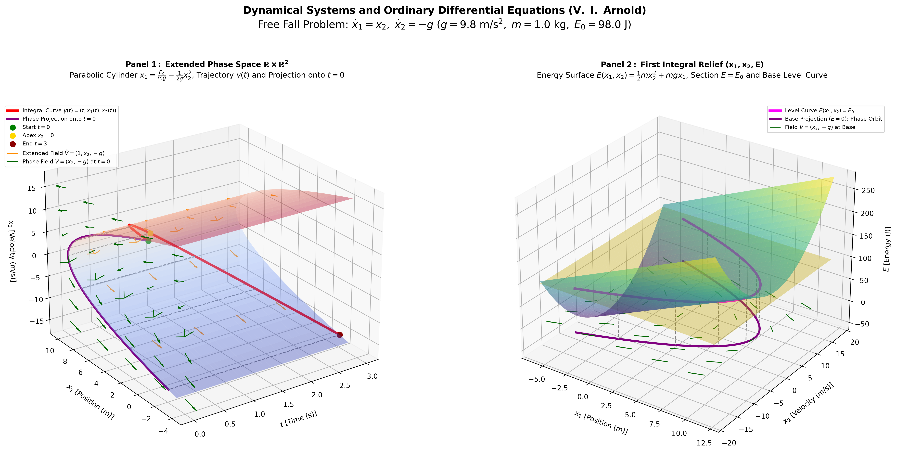

# Ordinary Differential Equations — V. I. Arnold

> **Graduate Studies in Applied Mathematics**  
> *Institute of Mathematics and Statistics (IME) — Federal University of Rio Grande do Sul (UFRGS), Brazil*

---

### 3D Visualization of Free Fall (Chapter 1, Example 1.1.14)



*Figure: Dual-panel 3D visualization of the free fall problem in extended phase space and mechanical energy relief (Chapter 1, Example 1.1.14). Source: Produced by the author.*

---

## 📖 About This Repository

This repository documents my **cover-to-cover study and computational implementation** of Vladimir I. Arnold's celebrated textbook **_Ordinary Differential Equations_** as part of my Master’s degree in **Applied Mathematics** at **UFRGS**.

V. I. Arnold's masterwork emphasizes a profoundly geometric and topological perspective on differential equations and dynamical systems:
- Viewing solutions not merely as algebraic formulas, but as **integral curves** and **phase flows** on manifolds;
- Exploring the geometry of **extended phase spaces** $\mathbb{R} \times M$, **invariant manifolds**, and **first integrals**;
- Rigorous scientific visualization of vector fields, conservation laws, and bifurcation phenomena.

---

## 🗂️ Repository Structure

The repository is organized chapter-by-chapter following Arnold's textbook:

```text
ode_arnold/
├── chapter_1/                                    # Chapter 1: Fundamental Concepts & Phase Spaces
│   ├── 1.1.8_example_the-logistic-curve.ipynb   # Logistic equation: x' = x(1 - x)
│   ├── 1.1.9_example_harvest-quotas.ipynb       # Population dynamics with harvesting quotas
│   ├── 1.1.14_example_free-fall.ipynb           # Free fall in extended phase space and energy relief
│   ├── 1.1.15_example_small-oscillations.ipynb  # Small oscillations (harmonic oscillator)
│   ├── pictures/                                # High-resolution publication renderings
│   │   ├── free_fall_arnold_3d.png
│   │   └── small_oscillations_arnold.png
│   └── scripts/                                 # Standalone Python scripts & interactive HTML
│       ├── free_fall_3d_arnold.py
│       ├── free_fall_arnold_3d.html
│       └── small_oscillations_arnold.py
├── requirements.txt                             # Python dependencies
└── README.md                                    # Repository overview and documentation
```

---

## 🚀 Featured Example: 1.1.14 Free Fall

For the classical free fall system $\dot{x}_1 = x_2, \; \dot{x}_2 = -g$ ($g = 9.8\ \text{m/s}^2, m = 1.0\ \text{kg}, E_0 = 98.0\ \text{J}$), we construct a **dual-panel 3D visualization**:

1. **Panel 1: The Extended Phase Space $\mathbb{R} \times \mathbb{R}^2$ with axes $(t, x_1, x_2)$**
   - **Invariant Manifold**: The parabolic cylinder $x_1(t, x_2) = \frac{E_0}{mg} - \frac{1}{2g}x_2^2$ embodying conservation of mechanical energy;
   - **Integral Curve**: 3D spatial trajectory $\gamma(t) = \left(t, -\frac{1}{2}gt^2 + v_0 t + x_0, -gt + v_0\right)$ lying directly on the cylinder;
   - **Extended Vector Field**: $\tilde{V} = (1, x_2, -g)$ tangent everywhere to the manifold;
   - **Phase Plane Projection at $t = 0$**: Parabolic phase orbit accompanied by the 2D autonomous vector field $V(x_1, x_2) = (x_2, -g)$ and orthogonal projection tie lines.

2. **Panel 2: First Integral Relief with axes $(x_1, x_2, E)$**
   - **Energy Surface**: $E(x_1, x_2) = \frac{1}{2}mx_2^2 + mgx_1$ forming an inclined parabolic trough;
   - **Constant Energy Plane**: Horizontal plane at $E = E_0 = 98.0\ \text{J}$;
   - **Level Curve & Base Projection**: Spatial intersection curve and its vertical projection onto the base phase plane $E = 0$, geometrically proving that **phase trajectories are the level curves of the mechanical energy function**.

---

## 🛠️ Getting Started

### 1. Clone the repository
```bash
git clone https://github.com/Ederson-Passos/ode_arnold.git
cd ode_arnold
```

### 2. Set up the virtual environment
```bash
python -m venv .venv

# On Windows (PowerShell):
.\.venv\Scripts\Activate.ps1

# On Linux/macOS:
source .venv/bin/activate
```

### 3. Install dependencies
```bash
pip install -r requirements.txt
```

### 4. Run the code
- **Jupyter Notebooks**: Open any notebook in VS Code or Jupyter Lab (e.g. `chapter_1/1.1.14_example_free-fall.ipynb` or `chapter_1/1.1.15_example_small-oscillations.ipynb`).
- **Interactive 3D HTML**: Open [`chapter_1/scripts/free_fall_arnold_3d.html`](chapter_1/scripts/free_fall_arnold_3d.html) in any web browser to rotate, pan, and zoom the 3D model with full WebGL hardware acceleration.
- **Standalone Python Scripts**:
  ```bash
  python chapter_1/scripts/free_fall_3d_arnold.py
  python chapter_1/scripts/small_oscillations_arnold.py
  ```

---

## 📚 References

- **Arnold, Vladimir I.** *Ordinary Differential Equations*. Translated from the Russian by Richard A. Silverman. The MIT Press / Springer-Verlag.

---
